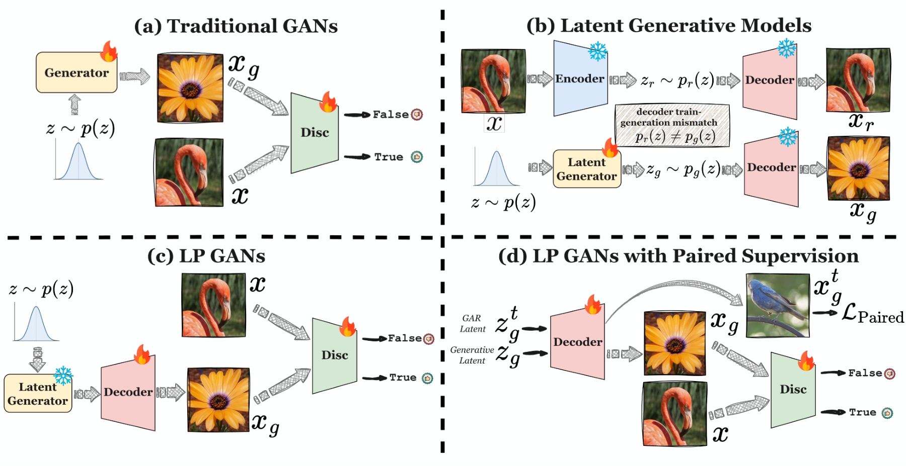
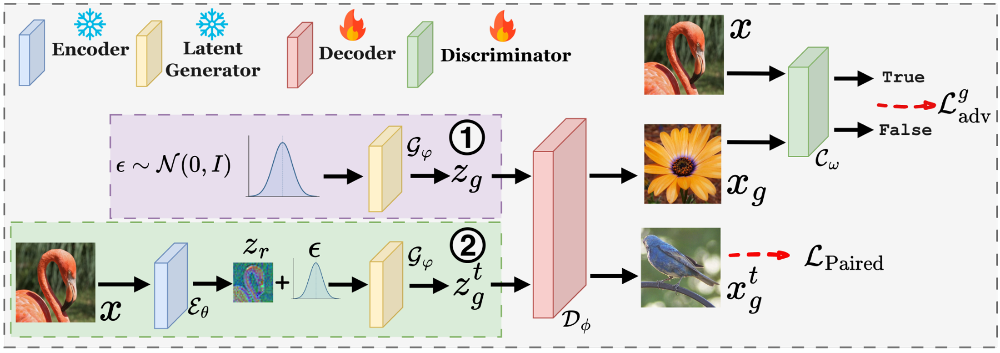

<div align="center">

# Latent Prior GANs

### Efficient Decoder Refinement via Inherited Generative Structure

[](https://github.com/WenjieShu/Latent-Prior-GAN)
[](https://wenjieshu.github.io/Latent-Prior-GAN/)
[](https://huggingface.co/wenjieshu/lpgan)
[](https://wenjieshu.github.io/)

**[Wenjie Shu](https://wenjieshu.github.io/)<sup>1,&#42;</sup> · [Xianghong Fang](https://sunset-clouds.github.io/)<sup>1,&#42;,†</sup> · Dehan Kong<sup>1</sup> · Tim G. J. Rudner<sup>1,2</sup>**

<sup>1</sup>University of Toronto &nbsp;&nbsp; <sup>2</sup>Vijil

<sup>&#42;</sup>: Equal contribution; <sup>†</sup>: Project lead.

</div>

LP-GANs refine the decoder of a latent generative model while freezing its latent prior and image encoder. Adversarial training improves generated images, while paired supervision (PS) anchors the decoder to source images. The refined decoder introduces no additional network at generation time.

<p align="center">
  <a href="docs/assets/LP_GAN_overview.pdf">
    
  </a>
  <br>
  <sub>LP-GANs inherit generative structure from a pretrained latent prior and refine the image decoder.</sub>
</p>

## Overview

- **LP-GANs w/ PS:** adversarial decoder refinement with paired supervision. Continuous priors use MSE and the experimental LPIPS/ConvNeXt perceptual loss; TiTok uses paired MSE. Both use the original adaptively weighted adversarial objective.
- **LP-GANs w/o PS:** the paper's ablation without paired supervision, selected with `--wo_ps`. The continuous-prior path skips paired reconstruction and uses the original adversarial objective.
- **Frozen generative structure:** the latent prior and image encoder stay fixed. Training preserves the experimental DINO discriminator, LeCAM, consistency regularization, and generator-before-discriminator update order.

<p align="center">
  <a href="docs/assets/LP_GAN_pipeline.pdf">
    
  </a>
  <br>
  <sub>Generation and paired reconstruction share the trainable decoder.</sub>
</p>

## Main Results

ImageNet-256 gFID with CFG, **as reported in the paper**. These are historical experiment results, not new GPU runs of this release. [Reproduction status](docs/reproduction.md) records the available evidence and unresolved checkpoint/result mappings.

| Evaluation protocol | Setting | iMF-B | iMF-M | iMF-L | iMF-XL |
|:--|:--|--:|--:|--:|--:|
| Official iMF / torch-fidelity | Original decoder | 3.37 | 2.27 | 1.86 | 1.73 |
| Official iMF / torch-fidelity | LP-GANs w/o PS | 2.55 | 2.07 | 1.78 | 1.69 |
| Official iMF / torch-fidelity | LP-GANs w/ PS | **2.08** | **1.73** | **1.48** | **1.32** |
| OpenAI | Original decoder | 3.47 | 2.40 | 1.90 | 1.80 |
| OpenAI | LP-GANs w/o PS | 2.56 | 2.06 | 1.82 | 1.67 |
| OpenAI | LP-GANs w/ PS | **2.14** | **1.77** | **1.51** | **1.51** |

## Supported Models

| Frozen prior | Decoder | Paired supervision | Sampling |
|:--|:--|:--|:--|
| iMF B / M / L / XL | SD-VAE MSE | generation-aware reconstruction at noise level η | official `.pth`, registered CFG interval, 1 step |
| DMF XL | SD-VAE MSE | native denoising of perturbed encoder latents | native checkpoint and source checkout, 1 step |
| MeanFlow XL | SD-VAE EMA | native trajectory from perturbed encoder latents | AlphaFlow snapshot loader and EMA VAE, 1 step |
| TiTok L32 / B64 | TiTok decoder modules | cached real tokens paired with center-cropped source images | frozen MaskGIT, 8 steps |

TiTok L32 has audited experiment evidence; B64 has architecture/interface support. TiTok retains the validated paired objective; a TiTok w/o PS experiment is not provided.

## Repository Structure

```text
Latent-Prior-GAN/
├── config.py                      # validated YAML / CLI configuration
├── train.py                       # single training entrypoint
├── eval_generation.py              # indexed generation and sample packing
├── eval_fid.py                     # explicit evaluation protocols
├── precompute_titok_real_tokens.py
├── precompute_titok_generated_tokens.py
├── check_titok_pairing.py
├── configs/                        # model-specific experiment defaults
├── models/                         # prior / tokenizer wrappers and GAN losses
├── data/                           # ImageNet loading and token-pool pairing
├── scripts/                        # portable torchrun launchers
├── tests/                          # CPU contract and training regression checks
└── docs/                           # project page, reproduction, and validation
```

Model defaults live in registries. Model wrappers expose `train_mode()`, `eval_mode()`, `trainable_parameters()`, and `last_layer`. Training outputs follow `(generated_images, paired_images)`; w/o PS returns `None` for the paired output. Losses, training, data pairing, and evaluation have separate responsibilities.

## Setup

Use Python 3.10+ and a CUDA training environment.

```bash
python -m venv .venv
source .venv/bin/activate
pip install -r requirements.txt
```

Place ImageNet in `data/imagenet/train/<class>/`. Supply original model weights separately; this repository contains no datasets or pretrained weights. The SD-VAE is loaded from `--vae_path`, environment overrides, or Hugging Face. Continuous paired training also needs DINO, VGG, ConvNeXt, and LPIPS projection weights. Supply LPIPS projection weights through `LPIPS_VGG_CKPT`; see [setup details](docs/reproduction.md).

For iMF, use **official PyTorch** weights at `checkpoints/imf/iMF-{B,M,L,XL}-2.pth`, or pass `--pretrained_imf_pytorch`. DMF/MeanFlow retain their native checkpoint formats and require original source checkouts. TiTok defaults to `checkpoints/titok/tokenizer_titok_l32.bin` and `generator_titok_l32.bin` (corresponding `b64` files for B64).

## Running the Experiments

### LP-GANs w/ PS

```bash
torchrun --standalone --nproc_per_node=8 train.py --config configs/imf_b.yaml \
  --dataset_dir data/imagenet --checkpoint_dir checkpoints/runs/imf_b \
  --saver_name_pre lpgan_imf_b_w_ps
```

### LP-GANs w/o PS

```bash
torchrun --standalone --nproc_per_node=8 train.py --config configs/imf_b.yaml \
  --wo_ps --dataset_dir data/imagenet \
  --checkpoint_dir checkpoints/runs/imf_b_wo_ps \
  --saver_name_pre lpgan_imf_b_wo_ps
```

Batch size is per GPU. Choose `configs/imf_m.yaml`, `imf_l.yaml`, or `imf_xl.yaml` for other scales. CLI values override YAML. Each backend exposes its supported options; unknown or ignored historical fields fail validation. Generation and paired CFG are controlled independently with `--no-use_cfg` and `--no-supervision_use_cfg`. See [reproduction instructions](docs/reproduction.md) for DMF and MeanFlow.

### TiTok

```bash
# Preserve the same source-image indices and labels in both pools.
python precompute_titok_real_tokens.py --dataset_dir data/imagenet \
  --tokenizer_name titok-vql32 --out pools/titok_real.npz
python precompute_titok_generated_tokens.py --generator_name titok-L32 \
  --num_samples 1281167 --label_pool pools/titok_real.npz \
  --deterministic --seed 3407 --out pools/titok_generated.npz

torchrun --standalone --nproc_per_node=8 train.py --config configs/titok_l32.yaml \
  --real_latent_pool pools/titok_real.npz \
  --generated_latent_pool pools/titok_generated.npz \
  --dataset_dir data/imagenet --checkpoint_dir checkpoints/runs/titok_l32 \
  --saver_name_pre lpgan_titok_l32_w_ps
```

Set `--num_samples` to the actual number of rows in the real pool. Training verifies source paths, labels, center-crop metadata, and tokenizer/generator pairing. Streamed generation resumes with `--deterministic`; incompatible shards require `--restart`. `check_titok_pairing.py` provides diagnostic re-encoding and an image grid.

### Launching and Resuming

The portable launcher `NPROC_PER_NODE=8 bash scripts/train.sh ...` accepts the same arguments. Use `python train.py --help` or `python train.py --prior_family titok --help` for family-specific options.

Resume a completed epoch using `--resume`. Saved optimizer learning rates take precedence; `--reset_resume_lr` explicitly applies new continuous-model learning rates. TiTok advances the original decoder LR decay exactly once on resume. Resuming between w/ PS and w/o PS objectives is rejected when checkpoint metadata identifies the objective. `--debug_steps` limits training steps for smoke runs; a checkpoint from an incomplete epoch cannot be resumed as a completed epoch.

## Evaluation and Outputs

```bash
# Omit --decoder_checkpoint to evaluate the original decoder.
NPROC_PER_NODE=8 bash scripts/eval_generation.sh --config configs/imf_b.yaml \
  --decoder_checkpoint checkpoints/runs/imf_b/checkpoint-lpgan_imf_b_w_ps-epoch005.pth.tar \
  --num_samples 50000 --out_dir results/imf_b_adapted

# TiTok uses its registered eight sampling steps.
NPROC_PER_NODE=8 bash scripts/eval_generation.sh --config configs/titok_l32.yaml \
  --decoder_checkpoint checkpoints/runs/titok_l32/checkpoint-lpgan_titok_l32_w_ps-epoch002.pth.tar \
  --out_dir results/titok_l32_adapted

pip install -r requirements-eval.txt
python eval_fid.py --protocol torch_fidelity \
  --samples results/imf_b_adapted/samples.npz \
  --reference /path/to/jit_in256_stats.npz --output results/imf_b_adapted/fid_torch.json
```

Evaluation can read the same model-specific YAML used for training, including TiTok, without requiring token pools. It starts from pretrained decoder weights and applies `--decoder_checkpoint` when supplied; a training `decoder_init: random` setting never changes the baseline.

Generation saves exactly indexed RGB PNGs, an `arr_0` uint8 NHWC NPZ, and a manifest with model, CFG, steps, and seeds. Existing nonempty output directories are refused. OpenAI evaluation uses `--protocol openai`, its TensorFlow dependency, and `VIRTUAL_imagenet256_labeled.npz`. **OpenAI and torch-fidelity numbers must be reported separately.**

## Validation

```bash
python -m unittest discover -s tests -v

# Development checks for project orchestration and wrappers.
pip install -r requirements-dev.txt
ruff check .
ruff format --check .
```

GitHub Actions runs the CPU contract suite, lint, formatting, and launcher syntax checks on pushes and pull requests. Upstream architecture files retain their source formatting.

CPU tests cover configuration, decoder gradients, GAN updates, unified training, checkpoint compatibility, pairing, sampling, and token-pool resume guards. [Validation details](docs/validation.md) describe the checks and remaining CUDA/DDP validation. [Migration and provenance](docs/migration.md) document source snapshots and checkpoint compatibility.

The static [project page](https://wenjieshu.github.io/Latent-Prior-GAN/) lives in `docs/index.html`, with styles and BibTeX copying adapted from GAR/FDDA. Preview it locally with `python -m http.server 8000 --directory docs`. GitHub Pages publishes `main` → `/docs`.

## Citation

If this work is useful for your research, please cite:

```bibtex
@article{shu2026latent,
  title   = {Latent Prior GANs: Efficient Decoder Refinement via Inherited Generative Structure},
  author  = {Shu, Wenjie and Fang, Xianghong and Kong, Dehan and Rudner, Tim G. J.},
  journal = {arXiv},
  year    = {2026}
}
```

## Acknowledgements

This release uses the original iMF, DMF, MeanFlow, TiTok, and DINO implementations and follows the research-code organization of [FDDA](https://github.com/sunset-clouds/Frechet-Distributional-Decoder-Alignment) and [GAR](https://github.com/sunset-clouds/Generation-Aware-Reconstruction). Upstream architecture and feature-network headers are retained. Model weights and external repositories remain subject to their upstream terms.
